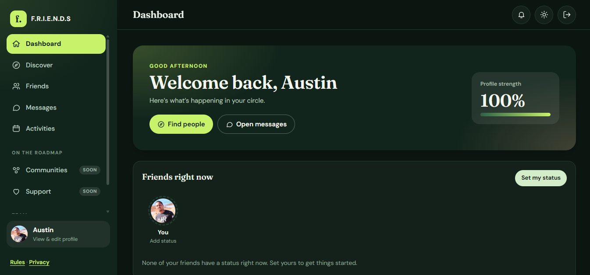
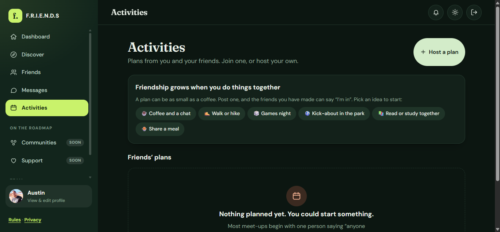

# F.R.I.E.N.D.S

**Meet people through what you love, build real friendships, and turn online hellos into real-life plans.**

F.R.I.E.N.D.S is a friendship-first social app for adults. It is not a dating app and it is not a follower-count feed: you share what you are up to with your friends, and you can invite them to do something together.

> **Status:** early beta, in active development. The web app is the main product and works end to end. The mobile app is a starter only.

## Screenshots


*Dashboard: see what your friends are up to right now, and set your own status.*


*Activities: host a plan, or join one from a friend.*

## What you can do today

**Connect**
- Sign up, log in, and recover a forgotten password
- Discover people by shared interests and send friend requests
- Message your friends directly

**Share**
- Post a status that lasts 24 hours, with an optional photo or song link
- A friends-only feed, so updates are seen by friends and nobody else
- Reactions on posts

**Do things together**
- Post an **open plan** (coffee, a walk, games night) with a place, a time and a limited number of spots
- Friends can join or leave, and the host can cancel
- Hosts and joiners are visible to friends only

**Feel safe**
- Block and report people; blocking is invisible to the person blocked
- A profile photo gallery, "Ask me about" prompts, and trust badges, including a photo-check badge reviewed by an admin
- Plain-language Rules and Privacy pages, with South African crisis helplines

**Run it**
- An admin area with connection numbers, member list, reports, plan overview and photo checks (admins only)
- Light and dark themes

## On the roadmap

- **Communities:** groups around hobbies, identities and goals, with moderated spaces and the option to join openly or anonymously
- **Support:** guided listening with clear boundaries (not therapy or crisis care)
- A full mobile app (the `apps/mobile` folder is an Expo starter)
- Member growth plan and richer discovery

## Built with

- [React 19](https://react.dev) and TypeScript
- [Vite](https://vite.dev)
- [Supabase](https://supabase.com) for authentication, Postgres database, file storage and row-level security
- Expo and React Native for the mobile starter

## Getting started

You need [Node.js](https://nodejs.org) with npm, and a free [Supabase](https://supabase.com) project.

### 1. Get the code

```bash
git clone https://github.com/austinprinsloo32-netizen/F.R.I.E.N.D.S-app.git
cd F.R.I.E.N.D.S-app
git checkout redesign/v2
```

### 2. Connect it to Supabase

Create `apps/web/.env.local` with your project's URL and publishable key (Supabase dashboard, Project Settings, API):

```env
VITE_SUPABASE_URL=https://YOUR-PROJECT.supabase.co
VITE_SUPABASE_PUBLISHABLE_KEY=YOUR_SUPABASE_PUBLISHABLE_KEY
```

### 3. Set up the database

Open the Supabase **SQL Editor**, then run these scripts from `supabase/` **in this order**. All of them are safe to run again.

| Order | Script | What it adds |
|------:|--------|--------------|
| 1 | `friends_feed.sql` | Statuses, posts, reactions and the friends-only feed |
| 2 | `safety.sql` | Blocking and reporting |
| 3 | `trust_gallery.sql` | Photo gallery, "Ask me about" prompts, photo-check badge |
| 4 | `plans.sql` | Open plans (Activities) |
| 5 | `admin.sql` | Admin role, metrics, reports and photo checks |
| 6 | `admin_members.sql` | Admin member list and plans overview |
| 7 | `status_media.sql` | Photo and song link on a status |

Optional:

- `status_expiry_optional.sql` makes the database enforce the 24-hour status expiry instead of the browser.
- `audit_policies.sql` is read-only. It lists your row-level security rules so you can review them.

**Make yourself an admin.** The last block of `admin.sql` (section 5) is commented out. Copy it into a new query, change the email in it to the one you log in with, remove the leading `--` on each line, and run it. An **Admin** link then appears in your menu.

> **Note:** the core tables (`profiles`, `friend_requests`, `conversations` and `messages`) are used by the app but are not yet created by any script in this repository. A brand-new Supabase project needs them added before step 3 will work. Until a base schema script is added, treat this repo as set up against an existing project.

### 4. Run it

```bash
cd apps/web
npm install
npm run dev
```

Open the address Vite prints, usually <http://localhost:5173>.

Other commands, from `apps/web`:

| Command | What it does |
|---------|--------------|
| `npm run build` | Type-checks and builds the site into `apps/web/dist` |
| `npm run preview` | Serves the production build locally |
| `npm run lint` | Runs ESLint |

### 5. Before you invite anyone

- In `apps/web/src/lib/site.ts`, set `OPERATOR_NAME` and `CONTACT_EMAIL` to details you are happy to publish. They appear on the public Rules and Privacy pages.
- In Supabase, go to Authentication, then URL Configuration, and set the Site URL and Redirect URLs for your deployed address and for `http://localhost:5173`.
- Re-check the helpline numbers in `site.ts` and have the Rules and Privacy pages reviewed. They are plain-language drafts, not legal advice, and POPIA applies in South Africa.

## Deploying

The web app builds to a static site, so free hosting works well: Netlify (drag and drop the `dist` folder) or Cloudflare Pages (connect the repo, root directory `apps/web`, build command `npm run build`, output directory `dist`). Add the two `VITE_SUPABASE_...` variables in your host's settings.

[DEPLOY.md](DEPLOY.md) has the full step-by-step checklist, including sign-up email limits and free-plan limits to know about.

## Project layout

```text
apps/
  web/         React + TypeScript web app (the main product)
    src/
      views/       Pages: Dashboard, Discover, Friends, Messages, Activities, Profile, Admin...
      components/  Shared UI: feed, status bar, photo gallery, safety actions...
      state/       App state and Supabase data hooks
      lib/         Supabase client, routing, site settings, helpers
    public/        Static files, including security headers (_headers)
  mobile/      Expo + React Native starter
supabase/      SQL scripts for tables, policies, storage, safety and admin
DEPLOY.md      Deployment and launch checklist
```

## Security

- The web app only ever uses Supabase's **publishable** key, which is designed to be public. Your data is protected by **row-level security** policies in the database, so check them (`audit_policies.sql` helps) before you invite people.
- Never commit the `service_role` key, passwords or any other secret. `.env` files are already ignored by git.
- Static hosts read `apps/web/public/_headers`, which sets browser security headers. The Content Security Policy is currently in report-only mode.

## License

No license has been chosen for this project yet, so all rights are reserved by default. `apps/mobile/LICENSE` is the Expo starter template's own license and does not cover the rest of the project.
